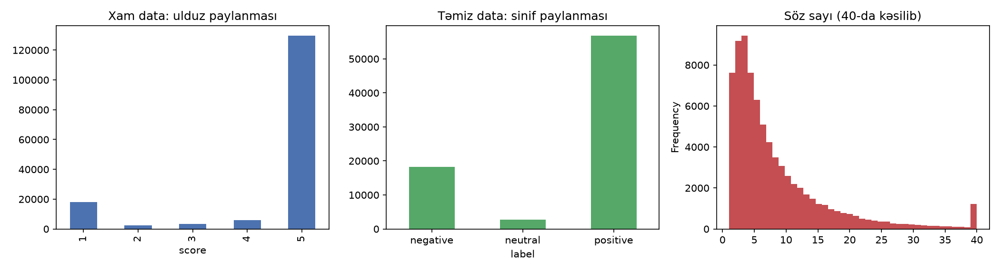
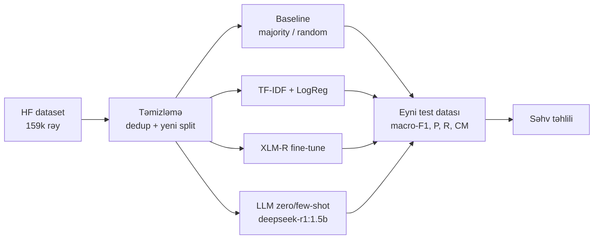
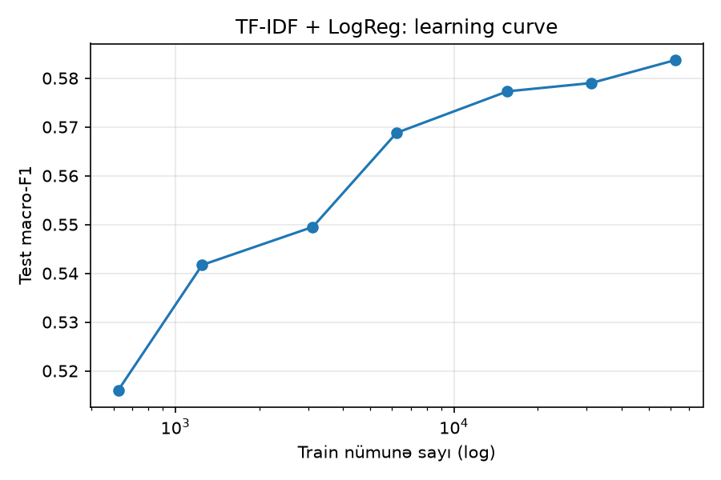
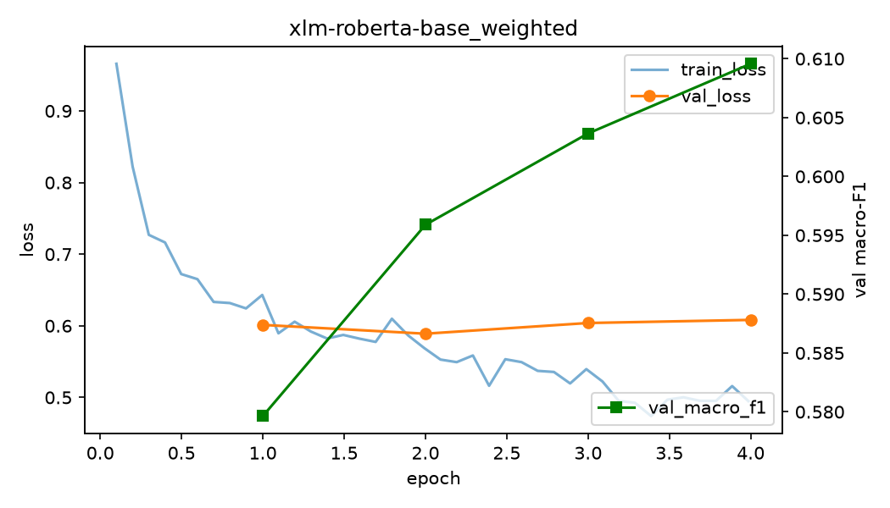
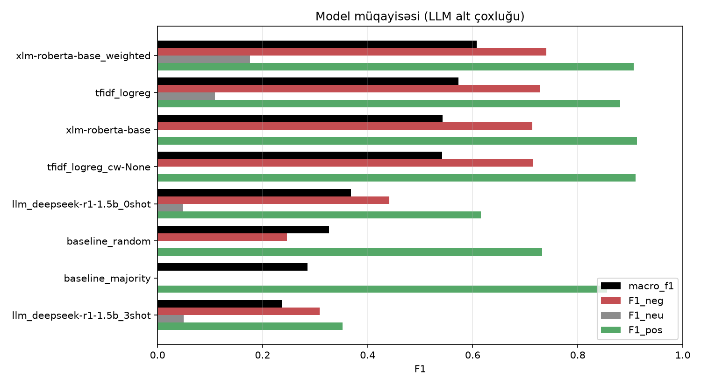
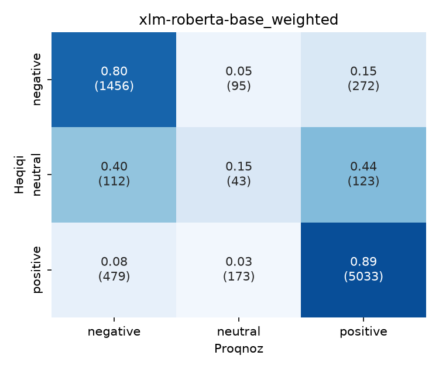
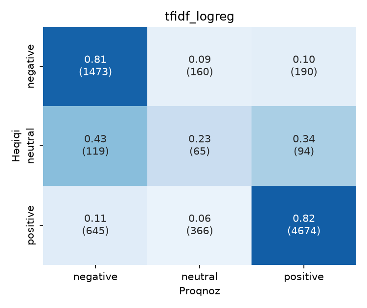
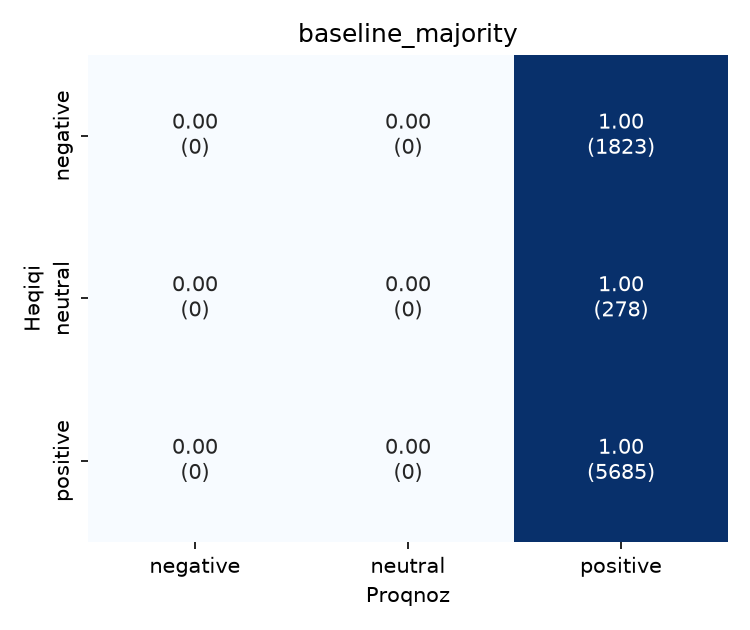

# Azərbaycan dilində tətbiq rəylərinin sentiment analizi

**Klassik ML, Transformer və LLM yanaşmalarının müqayisəsi**

Süni intellekt fənni · Sərbəst iş · Mövzu: *Azərbaycan dilində sadə mətn təsnifatı və sentiment analizi*
Müəllif: Fuad Sadigov · 2026

> [!NOTE]
> Bu səhifə həm təqdimat, həm texniki hesabatdır. Hər bölmə bir "slayd"dır. Kod parçaları ▸ işarəli bölmələrdə gizlədilib, açmaq üçün klikləyin.

---

## 1. Problem

Google Play-də Azərbaycan tətbiqlərinə (bank, taksi, çatdırılma) minlərlə rəy yazılır. Bu rəyləri **avtomatik olaraq neqativ, neytral və pozitiv** siniflərə ayırmaq şirkətə şikayətləri tez tapmağa və məhsulu yaxşılaşdırmağa kömək edir.

**Niyə çətindir?**
- Azərbaycan dili **az resurslu dildir** (low-resource language): hazır model və etiketli data azdır.
- Rəylər qısa və qeyri-rəsmidir: "ela", "əla", "eladi", "əladır" eyni sözün yazılışlarıdır. Rus və türk sözləri, emojilər də qarışır.
- Siniflər **balanssızdır**: rəylərin 73%-i pozitivdir.

**Tədqiqat sualı:** Az resurslu dildə hansı yanaşma daha yaxşı işləyir: klassik ML (Machine Learning), öyrədilmiş transformer, yoxsa heç öyrədilməmiş LLM (Large Language Model)?

---

## 2. Dataset

| | |
|---|---|
| Mənbə | [`hajili/azerbaijani_review_sentiment_classification`](https://huggingface.co/datasets/hajili/azerbaijani_review_sentiment_classification), HF (Hugging Face) Hub |
| Lisenziya | MIT: açıq istifadə |
| Məzmun | 159 419 Google Play rəyi, 1–5 ulduz |
| Label | 1–2★ → **negative** · 3★ → **neutral** · 4–5★ → **positive** |

### EDA (Exploratory Data Analysis): dataset "hazır" görünür, amma deyil

| Tapıntı | Rəqəm | Nəticəsi |
|---|---|---|
| **Leakage** (test-in train-ə sızması) | Orijinal test-in **52.9%**-i train-də də var | Nəticələr şişirdilmiş olardı |
| **Dublikatlar** | 159k sətrin yalnız **77 855**-i unikaldır; "əla" 17 557 dəfə | Model eyni şeyi dəfələrlə görür |
| **Balanssızlıq** | negative 23.4% · **neutral 3.6%** · positive 73.0% | Accuracy aldadıcı olur |
| **Label səs-küyü** | Şikayət + 5★, sual + 1★; 655 mətn dublikatlarda fərqli label daşıyır | Modelin tavanını aşağı salır |
| Mətn uzunluğu | median **5 söz**, p95 (95th percentile) = 25 | Qısa, kontekst az |



**Həll:** train və test birləşdirildi, dublikatlar silindi (eyni mətnin fərqli label-ları arasında çoxluq label-ı seçildi), sonra **stratified 80/10/10** bölündü:
train **62 284** · validation **7 785** · test **7 786**. Beləliklə eyni mətn həm train-də, həm test-də ola bilməz.

---

## 3. Metodologiya



| # | Yanaşma | Öyrədilir? | Ölçü |
|---|---|---|---|
| 0 | **Baseline**: hamıya "positive" və ya təsadüfi | yox | — |
| 1 | **TF-IDF** (Term Frequency – Inverse Document Frequency) + **LogReg** (Logistic Regression) | bəli, CPU-da ~15 san | ~156k xüsusiyyət (söz + simvol n-qram) |
| 2 | **XLM-R** (XLM-RoBERTa: Cross-lingual Language Model – Robustly Optimized BERT Pretraining Approach), fine-tune | bəli, GPU-da ~25 dəq | 278M parametr |
| 3 | **LLM** deepseek-r1:1.5b, Ollama ilə lokal | **yox**, yalnız prompt | 1.5B parametr |

### Əsas metrika: macro-F1

- **Precision (P):** model "neqativ" dediyi rəylərin neçə faizi doğrudan neqativdir?
- **Recall (R):** həqiqi neqativlərin neçə faizini tapıb?
- **F1 = 2·P·R / (P+R):** ikisinin harmonik ortası. Biri pis olanda F1 də pis olur.
- **Macro-F1:** hər sinfin F1-i ayrıca hesablanır, sonra sadə ortası götürülür. **Hər sinif bərabər səs verir.**

> [!IMPORTANT]
> Niyə accuracy yox? Hamıya "positive" deyən model, heç nə öyrənmədən **73% accuracy** alır, amma macro-F1-i **0.28**-dir.

Hiperparametrlər yalnız **validation** datasında seçildi. Test datasına hər model üçün **bir dəfə** baxıldı.

---

## 4. Model 1: TF-IDF + Logistic Regression

**İdeya:** hər rəy ədədlər vektoruna çevrilir. Söz bu rəydə tez-tez keçirsə (TF), amma bütün rəylərdə nadirdirsə (IDF), çəkisi böyük olur. Bu vektor üzərində xətti təsnifatçı öyrədilir.

- **Söz n-qramları (1–2):** "geri", "geri qaytarın".
- **Simvol n-qramları (2–5):** "ela / əla / eladi" yazılışlarının ortaq hissələrini tutur.
- **`class_weight="balanced"`:** az sinfin səhvi daha baha başa gəlir (neutral ×9.3, positive ×0.46).

<details>
<summary>▸ Kod</summary>

```python
features = FeatureUnion([
    ("word", TfidfVectorizer(analyzer="word",    ngram_range=(1, 2), sublinear_tf=True)),
    ("char", TfidfVectorizer(analyzer="char_wb", ngram_range=(2, 5), sublinear_tf=True)),
])
model = Pipeline([("tfidf", features),
                  ("clf", LogisticRegression(C=0.5, class_weight="balanced"))])
```
</details>

| Variant | Accuracy | Macro-F1 | Neutral recall |
|---|---|---|---|
| class_weight = balanced | 0.798 | **0.585** | 0.23 |
| Çəkisiz | **0.854** | 0.548 | **0.00** |

Çəkisiz model accuracy-də "qalib" görünür, amma **neytralı heç vaxt tapmır**.

### Learning curve: data artdıqca nə dəyişir?

| Train nümunə | 623 | 1 247 | 3 114 | 6 229 | 15 571 | 31 142 | 62 284 |
|---|---|---|---|---|---|---|---|
| Test macro-F1 | 0.516 | 0.542 | 0.550 | 0.569 | 0.577 | 0.579 | 0.584 |



15k nümunədən sonra data 4 dəfə artır, amma qazanc cəmi +0.007-dir. Klassik model öz tavanına çatıb.

### Leakage təcrübəsi

| Eyni model | Test n | Accuracy | Macro-F1 |
|---|---|---|---|
| Orijinal split (dublikat + leakage) | 31 885 | **0.834** | 0.569 |
| Təmiz split | 7 786 | 0.798 | 0.585 |

Orijinal split accuracy-ni **+3.6 bənd şişirdir**: test-in yarısı modelin artıq gördüyü "əla / super" rəyləridir.

---

## 5. Model 2: XLM-RoBERTa fine-tune

**İdeya:** transfer learning. Facebook AI modeli 100 dildə (Azərbaycan dili daxil), 2.5 TB mətndə öyrədib, yəni model dili artıq "bilir". Biz onun üstünə 3 çıxışlı kiçik bir təsnifat qatı qoyuruq və bütün şəbəkəni öz rəylərimizlə 4 epoch öyrədirik.

Tokenizer sözləri subword hissələrə bölür:
```
"Proqram donur, pulumu geri qaytarın" → ▁Pro qram ▁do nur , ▁pul umu ▁geri ▁qaytar ın
```
TF-IDF-dən fərqli olaraq, attention mexanizmi sayəsində hər söz **kontekstə görə** təmsil olunur.

<details>
<summary>▸ Kod</summary>

```python
model = AutoModelForSequenceClassification.from_pretrained("FacebookAI/xlm-roberta-base", num_labels=3)

class WeightedTrainer(Trainer):          # balanssızlığa qarşı çəkili loss
    def compute_loss(self, model, inputs, return_outputs=False, num_items_in_batch=None):
        labels = inputs.pop("labels")
        out = model(**inputs)
        loss = F.cross_entropy(out.logits, labels, weight=self.class_weights)  # [1.19, 3.05, 0.68]
        return (loss, out) if return_outputs else loss

args = TrainingArguments(num_train_epochs=4, learning_rate=2e-5, per_device_train_batch_size=32,
                         eval_strategy="epoch", load_best_model_at_end=True,
                         metric_for_best_model="macro_f1")
trainer = WeightedTrainer(..., callbacks=[EarlyStoppingCallback(early_stopping_patience=2)])
```
</details>

| Epoch | val_loss | val macro-F1 |
|---|---|---|
| 1 | 0.601 | 0.580 |
| 2 | **0.589** ← min | 0.596 |
| 3 | 0.604 | 0.604 |
| 4 | 0.608 | **0.610** ← saxlanan model |



val_loss 2-ci epoch-dan sonra qalxır, amma macro-F1 artmağa davam edir. Model **məqsəd metrikasına** görə seçilir.

| Variant | Accuracy | Macro-F1 | F1 neg | F1 neu | F1 pos |
|---|---|---|---|---|---|
| Çəkili loss | 0.839 | **0.601** | 0.752 | 0.146 | 0.906 |
| Çəkisiz loss | **0.860** | 0.575 | 0.752 | 0.058 | 0.915 |

Accuracy tələsi transformer-də də təkrarlanır: çəkisiz model neytralın yalnız 3%-ni tapır.

---

## 6. Model 3: LLM (öyrətmə olmadan)

deepseek-r1:1.5b lokal olaraq Ollama ilə işlədi. Modelə yalnız sinif tərifləri verildi, cavab JSON formatında, sxemlə məhdudlaşdırılmış şəkildə alındı. Test eyni 500 nümunədə aparıldı.

<details>
<summary>▸ Kod</summary>

```python
SCHEMA = {"type": "object", "properties": {"label": {"enum": ["negative", "neutral", "positive"]}}}
resp = ollama.chat(model="deepseek-r1:1.5b",
                   messages=[{"role": "system", "content": SYSTEM}, *shots,
                             {"role": "user", "content": f"Review: {text}"}],
                   format=SCHEMA, options={"temperature": 0, "num_predict": 1024})
```
</details>

| Model (eyni 500 nümunə) | Accuracy | Macro-F1 | San/nümunə |
|---|---|---|---|
| deepseek 0-shot | 0.510 | 0.368 | 10.6 |
| deepseek 3-shot | 0.246 | **0.237** | 4.5 |
| *Təsadüfi baseline* | *0.596* | *0.326* | — |
| *XLM-R (müqayisə üçün)* | *0.844* | *0.608* | <0.01 |

**Müşahidələr:**
1. **Dili tanımır.** Reasoning izində model belə yazır: *"'yaxşıdı', which is a Turkish word…"*. Azərbaycan dilini türkcə ilə qarışdırır.
2. **Few-shot nəticəni pisləşdirdi.** Prompt-a hər sinifdən 3 nümunə qoyduq, yəni neytral 33% göründü (realda 3%). Model 500 rəyin **306-na** "neutral" dedi. Üstəlik nümunələrdəki qısa JSON cavablarını kopyalayıb düşünməyi dayandırdı. Kiçik model **formatı** təqlid edir, **mühakiməni** yox.

---

## 7. Yekun müqayisə

| Model | Accuracy | **Macro-F1** | F1 neg | F1 neu | F1 pos |
|---|---|---|---|---|---|
| **XLM-R, çəkili** | 0.839 | **0.601** | **0.752** | 0.146 | 0.906 |
| TF-IDF + LogReg, balanced | 0.798 | 0.585 | 0.726 | **0.150** | 0.878 |
| XLM-R, çəkisiz | **0.860** | 0.575 | 0.752 | 0.058 | **0.915** |
| TF-IDF, çəkisiz | 0.854 | 0.548 | 0.734 | 0.000 | 0.911 |
| deepseek-r1 0-shot\* | 0.510 | 0.368 | 0.441 | 0.048 | 0.615 |
| Təsadüfi baseline | 0.596 | 0.337 | 0.236 | 0.042 | 0.735 |
| Majority baseline | 0.730 | 0.281 | 0.000 | 0.000 | 0.844 |

\* LLM 500 nümunəlik alt çoxluqda ölçülüb, qalanları 7 786 nümunədə.



| XLM-R çəkili | TF-IDF balanced | Majority baseline |
|---|---|---|
|  |  |  |

---

## 8. Səhv təhlili

XLM-R testdə 1254 rəydə yanılır (16.1%). Səhvlər harada cəmlənir?

| Dilim | n | Accuracy | Macro-F1 | F1 neu |
|---|---|---|---|---|
| 1–2 söz | 1 699 | **0.913** | 0.531 | 0.045 |
| 16+ söz | 1 092 | 0.738 | 0.584 | **0.173** |
| Azərbaycan hərfləri (ə, ş, ç…) var | 5 024 | 0.830 | 0.604 | 0.154 |
| Azərbaycan hərfləri yox | 2 762 | 0.855 | 0.593 | 0.120 |
| Dublikatlarda ziddiyyətli label | 77 | 0.766 | **0.490** | 0.000 |

**Səhvlərin bir hissəsi model səhvi deyil, label səhvidir.** Model neytral deyib, label isə neqativdir:

- [1★] *"Maaş köçəndə sms necə gəlir?"*: əslində sualdır.
- [1★] *"Salam. Yeni versiya nə vaxt olacaqdır?…"*
- [2★] *"Z 445s4"*: mənasız mətn.

Ulduz rəyin mətnini deyil, istifadəçinin ümumi əhvalını ölçür. Neytral sinif (3★) xüsusilə səs-küylüdür.

---

## 9. Nəticələr

1. **Data keyfiyyəti model ölçüsündən vacibdir.** Leakage, dublikat və label səs-küyü nəticəni modeldən çox müəyyən edir.
2. **Accuracy aldadır.** Balanssız datada macro-F1 və sinif üzrə recall lazımdır. Hər iki model ailəsində ən yüksək accuracy-ni neytralı tanımayan model alıb.
3. **Transfer learning kömək edir, amma az.** XLM-R TF-IDF-dən cəmi +0.016 macro-F1 qazandırır, bunun üçün ~100 dəfə çox hesablama sərf olunur.
4. **Neytral sinfin tavanı var.** İki fərqli model eyni ~0.15 F1-də ilişib qalır.
5. **Öyrədilmiş kiçik model öyrədilməmiş LLM-dən güclüdür.** Dar tapşırıqda 278M-lik XLM-R 1.5B-lik LLM-i 0.24 macro-F1 fərqlə qabaqlayır.

### Praktiki tövsiyə

Şikayətləri tapmaq üçün **XLM-R çəkili** modeli istifadə etmək olar: neqativ recall 0.80, precision 0.71. Ehtiyat və sürət lazımdırsa, **TF-IDF** praktiki olaraq demək olar eyni nəticə verir, saniyələrlə öyrədilir və CPU-da işləyir.

---

## 10. Məhdudiyyətlər

- **Label = ulduz:** label insan tərəfindən mətnə görə qoyulmayıb, ulduzdan çıxarılıb. Bu, neytral sinfi xüsusilə zəiflədir.
- **Domen:** yalnız Google Play rəyləridir, əsasən bank və xidmət tətbiqləri. Sosial media və xəbər mətnlərinə ümumiləşdirilməyə bilər.
- **LLM:** yalnız bir kiçik model (1.5B) yoxlanılıb. Daha böyük LLM-lər GPU limitlərinə görə sınanmadı.
- **Kontekst:** rəyin hansı tətbiqə aid olduğu nəzərə alınmayıb.
- **Bir seed:** nəticələr bir təsadüfi bölgü (seed = 42) üzərindədir, variasiya ölçülməyib.

## 11. Etika və məsuliyyətli AI

- **Məxfilik:** data ictimai rəylərdən ibarətdir və istifadəçi adları yoxdur. Buna baxmayaraq, rəylərdə telefon və kart nömrəsi kimi şəxsi məlumat ola bilər. Real istifadədə əvvəlcədən anonimləşdirmə lazımdır.
- **Qərəz:** model ə, ş, ç hərfləri olmadan yazılmış mətnlərdə bir az zəifdir. Bu, standart əlifbadan istifadə etməyən istifadəçilərin şikayətlərinin daha çox qaçırılması deməkdir.
- **Avtomatlaşdırma riski:** neqativ recall 0.80-dir, yəni hər 5 şikayətdən 1-i qaçırılır. Model insan baxışını əvəz etməməli, prioritetləşdirmə üçün istifadə olunmalıdır.
- **Şəffaflıq:** bütün kod, data split-i və proqnozlar açıqdır, nəticələr təkrarlana bilir.

---

## 12. Qısaltmalar (Abbreviations)

| Qısaltma | İngiliscə açılışı |
|---|---|
| AI | Artificial Intelligence |
| ML | Machine Learning |
| NLP | Natural Language Processing |
| EDA | Exploratory Data Analysis |
| HF | Hugging Face |
| TF-IDF | Term Frequency – Inverse Document Frequency |
| LogReg | Logistic Regression |
| BERT | Bidirectional Encoder Representations from Transformers |
| XLM-R | XLM-RoBERTa: Cross-lingual Language Model – Robustly Optimized BERT Pretraining Approach |
| LLM | Large Language Model |
| P / R / F1 | Precision / Recall / F1-score (harmonic mean of P and R) |
| CM | Confusion Matrix |
| GPU / CPU | Graphics / Central Processing Unit |
| JSON | JavaScript Object Notation |
| p95 | 95th percentile |

## 13. İstinadlar (References)

1. Hajili, *azerbaijani_review_sentiment_classification* dataset. Hugging Face Hub. https://huggingface.co/datasets/hajili/azerbaijani_review_sentiment_classification
2. Conneau, A. et al. (2020). *Unsupervised Cross-lingual Representation Learning at Scale.* ACL 2020. arXiv:1911.02116
3. Liu, Y. et al. (2019). *RoBERTa: A Robustly Optimized BERT Pretraining Approach.* arXiv:1907.11692
4. Devlin, J. et al. (2019). *BERT: Pre-training of Deep Bidirectional Transformers for Language Understanding.* NAACL 2019. arXiv:1810.04805
5. Vaswani, A. et al. (2017). *Attention Is All You Need.* NeurIPS 2017. arXiv:1706.03762
6. DeepSeek-AI (2025). *DeepSeek-R1: Incentivizing Reasoning Capability in LLMs via Reinforcement Learning.* arXiv:2501.12948
7. Salton, G. & Buckley, C. (1988). *Term-weighting approaches in automatic text retrieval.* Information Processing & Management, 24(5).
8. He, H. & Garcia, E. A. (2009). *Learning from Imbalanced Data.* IEEE Transactions on Knowledge and Data Engineering, 21(9).
9. Kaufman, S. et al. (2012). *Leakage in Data Mining: Formulation, Detection, and Avoidance.* ACM TKDD, 6(4).
10. Northcutt, C. et al. (2021). *Pervasive Label Errors in Test Sets Destabilize Machine Learning Benchmarks.* NeurIPS Datasets and Benchmarks. arXiv:2103.14749
11. Pedregosa, F. et al. (2011). *Scikit-learn: Machine Learning in Python.* JMLR 12.
12. Wolf, T. et al. (2020). *Transformers: State-of-the-Art Natural Language Processing.* EMNLP 2020 (System Demonstrations).

---

## Əlavə: kodu işə salmaq

<details>
<summary>▸ Quraşdırma və addımlar</summary>

```bash
uv sync                                   # Python 3.12, PyTorch CUDA
ollama pull deepseek-r1:1.5b              # yalnız LLM addımı üçün

uv run scripts/01_prepare_data.py         # yükləmə, EDA, dedup, split → data/processed
uv run scripts/02_baselines.py
uv run scripts/03_tfidf.py                # grid, leakage təcrübəsi, learning curve
uv run scripts/04_transformer.py --weighted
uv run scripts/04_transformer.py          # çəkisiz variant
uv run scripts/05_llm.py --shots 0 --n 500
uv run scripts/05_llm.py --shots 3 --n 500
uv run scripts/06_compare.py              # results/comparison.md
uv run scripts/07_error_analysis.py --model xlm-roberta-base_weighted --other tfidf_logreg
```

GPU yoxdursa: [`colab.ipynb`](colab.ipynb) (Google Colab, T4 GPU).
Windows-da Azərbaycan hərfləri konsolda xəta verərsə: `$env:PYTHONIOENCODING="utf-8"`.

**Struktur:**
```
src/az_sentiment/   data.py (yükləmə, dedup, split) · metrics.py (ortaq qiymətləndirmə)
scripts/            01–07 addımlar
data/processed/     təmiz split (parquet)
results/            metrics/*.json · figures/*.png · preds/*.csv · comparison.md · errors_*.md
docs/               kod_ve_neticeler.md: ətraflı kod + nəticə qeydləri
```
</details>
