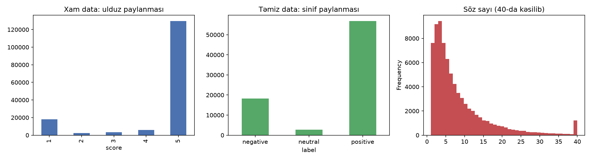
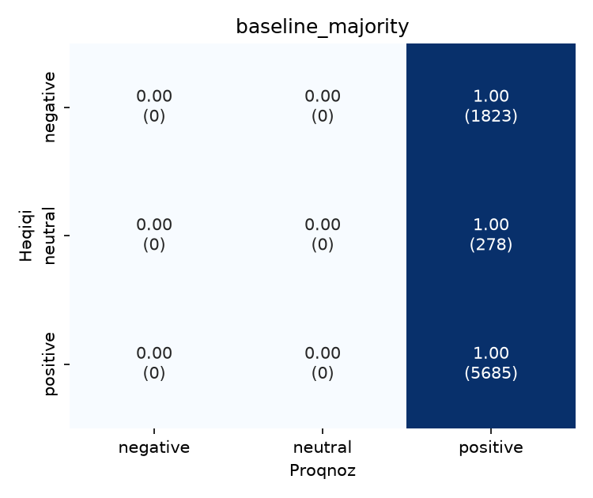
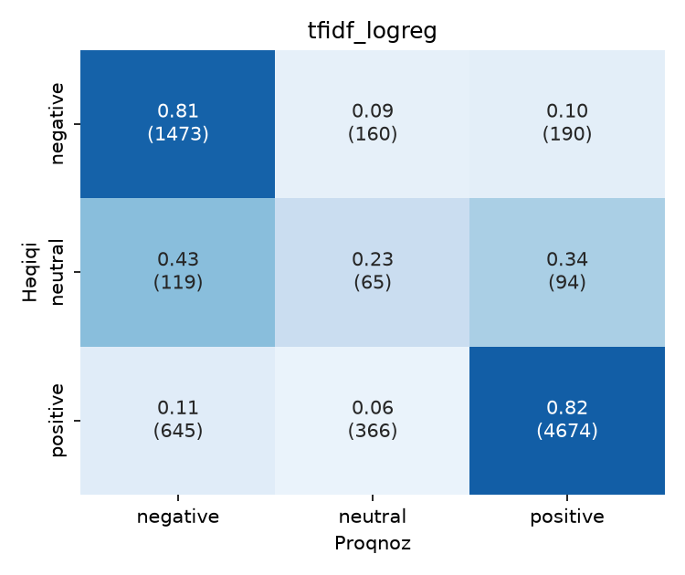
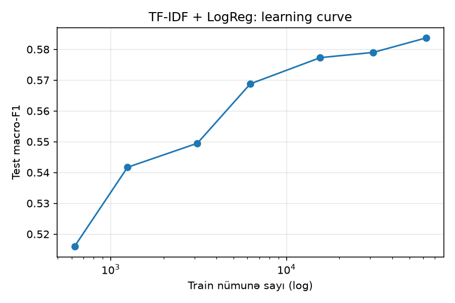
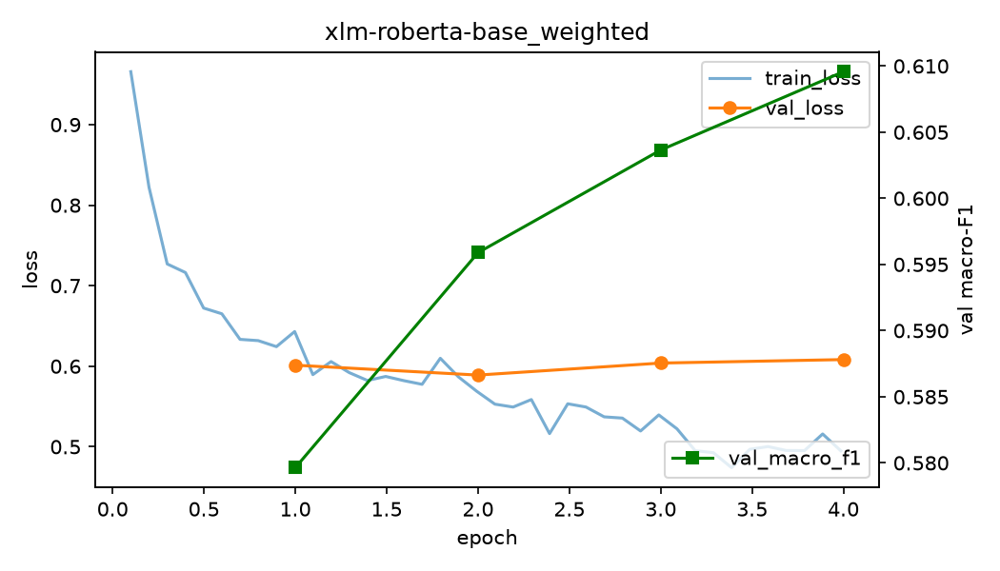
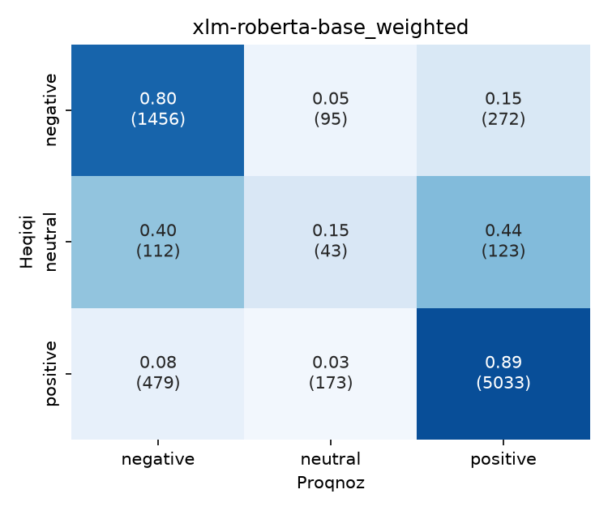

# Təqdimat materialı: kod + nəticələr

Hər mərhələ: **nə etdik → əsas kod (slayda sığan) → nəticə → slayd mesajı**.
Tam kod `scripts/` və `src/az_sentiment/` altındadır. Bütün rəqəmlər təmiz test datasındandır (n = 7786), əksi qeyd olunubsa başqa.

### Qısaltmalar (Abbreviations)

| Qısaltma | İngiliscə açılışı | Qısa izah |
|---|---|---|
| AI | Artificial Intelligence | Süni intellekt |
| ML | Machine Learning | Maşın öyrənməsi |
| NLP | Natural Language Processing | Təbii dilin emalı |
| EDA | Exploratory Data Analysis | Datanın ilkin təhlili |
| HF | Hugging Face | Model/dataset platforması (Hub) |
| TF-IDF | Term Frequency – Inverse Document Frequency | Sözün mətndə tezliyi × bütün mətnlərdə nadirliyi |
| LogReg | Logistic Regression | Xətti təsnifat modeli |
| BERT | Bidirectional Encoder Representations from Transformers | Google-un encoder transformer modeli |
| XLM-R | XLM-RoBERTa: Cross-lingual Language Model – Robustly Optimized BERT Pretraining Approach | 100 dildə öyrədilmiş çoxdilli transformer |
| LLM | Large Language Model | Böyük dil modeli |
| F1 | F1-score | Precision və recall-un harmonik ortası |
| P / R | Precision / Recall | Dəqiqlik / əhatə |
| CM | Confusion Matrix | Həqiqi vs proqnoz sinif cədvəli |
| neg / neu / pos | negative / neutral / positive | Sinif adları |
| val | validation | Hiperparametr seçmək üçün ayrılmış data |
| p95 | 95th percentile | Dəyərlərin 95%-i bundan kiçikdir |
| JSON | JavaScript Object Notation | Strukturlaşdırılmış mətn formatı |
| GPU / CPU | Graphics / Central Processing Unit | Qrafik / mərkəzi prosessor |
| bf16 / fp16 | bfloat16 (brain floating point) / 16-bit floating point | Yarım dəqiqlikli ədəd formatları, təlimi sürətləndirir |
| it/s | iterations per second | Saniyədə emal olunan batch sayı |

---

## 1. Data və EDA (Exploratory Data Analysis): problemin tapılması

**Nə etdik:** HF (Hugging Face) Hub-dan dataset (159k Google Play rəyi, 1–5★) yükləndi, ulduz → 3 sinif çevrildi, keyfiyyət yoxlandı.

```python
def score_to_label(score):          # 1-2★ → negative, 3★ → neutral, 4-5★ → positive
    return 0 if score <= 2 else 1 if score == 3 else 2

# Leakage yoxlaması: orijinal test-in neçə faizi train-də də var?
train_norm = set(tr["text"].map(normalize))
leak = te["text"].map(normalize).isin(train_norm).mean()      # → 0.529
```

**Nəticə:**

| Göstərici | Dəyər |
|---|---|
| Xam sətir | 159 419 |
| Unikal mətn | 77 855 (yalnız ~49%) |
| Orijinal test-in train-də olan hissəsi | **52.9%** (leakage) |
| Ən çox təkrarlanan | "əla" 17 557 dəfə, "super" 11 226 |
| Sinif payı (təmiz) | negative 23.4% · **neutral 3.6%** · positive 73.0% |
| Dublikatlarda ziddiyyətli label | 655 mətn |
| Söz sayı | median 5, p95 (95th percentile) = 25 |
| Azərbaycan hərfi (ə, ş, ç…) olan mətn | 65.1% |



**Slayd mesajı:** Dataset "hazır" görünür, amma yarısı dublikatdır və test train-ə sızıb. Neytral sinif çox azdır.

---

## 2. Təmizləmə və düzgün split

```python
full = dedup(pd.concat([tr, te]))                    # normallaşdırılmış mətnə görə 1 nüsxə
train, rest = train_test_split(full, test_size=0.2, stratify=full["label"], random_state=42)
val, test   = train_test_split(rest, test_size=0.5, stratify=rest["label"], random_state=42)
```

**Nəticə:** train 62 284 · val 7 785 · test 7 786. Eyni mətn iki split-də ola bilməz.

**Slayd mesajı:** Hiperparametrlər yalnız **val** (validation) datasında seçilir, **test**-ə bir dəfə baxılır.

---

## 3. Baseline: metrika seçimi

```python
DummyClassifier(strategy="most_frequent")   # hamıya "positive"
DummyClassifier(strategy="stratified")      # paylanmaya görə təsadüfi
```

| Model | Accuracy | Macro-F1 | F1 neg | F1 neu | F1 pos |
|---|---|---|---|---|---|
| Hamıya "positive" | **0.730** | **0.281** | 0.000 | 0.000 | 0.844 |
| Təsadüfi | 0.596 | 0.337 | 0.236 | 0.042 | 0.735 |



**Slayd mesajı:** Heç nə öyrənməyən model 73% accuracy alır. Ona görə əsas metrika **macro-F1**-dir: hər sinfin F1-score-u (precision və recall-un harmonik ortası) ayrıca hesablanır və sadə ortası götürülür, yəni hər sinif bərabər səs verir.

---

## 4. Klassik ML (Machine Learning): TF-IDF (Term Frequency – Inverse Document Frequency) + Logistic Regression

```python
features = FeatureUnion([
    ("word", TfidfVectorizer(analyzer="word",    ngram_range=(1, 2), sublinear_tf=True)),
    ("char", TfidfVectorizer(analyzer="char_wb", ngram_range=(2, 5), sublinear_tf=True)),
])   # simvol n-qramları "ela / əla / eladi / əladır" fərqini tutur
model = Pipeline([("tfidf", features),
                  ("clf", LogisticRegression(C=0.5, class_weight="balanced"))])
```

**Hiperparametr axtarışı (validation, macro-F1):**

| class_weight | C=0.5 | C=2 | C=8 |
|---|---|---|---|
| None | 0.540 | 0.554 | 0.556 |
| **balanced** | **0.582** | 0.579 | 0.573 |

**Test nəticəsi:**

| Model | Accuracy | Macro-F1 | F1 neg | F1 neu | F1 pos | Recall neu |
|---|---|---|---|---|---|---|
| TF-IDF, balanced | 0.798 | **0.585** | 0.726 | 0.150 | 0.878 | 0.23 |
| TF-IDF, çəkisiz | **0.854** | 0.548 | 0.734 | **0.000** | 0.911 | **0.00** |



**Slayd mesajı:** Çəkisiz model accuracy-də "qalib" gəlir, amma neytralı **heç vaxt** tapmır. Sinif çəkiləri accuracy-ni azaldır, macro-F1-i artırır.

### 4a. Leakage təcrübəsi (eyni model, orijinal split)

| Split | Test n | Accuracy | Macro-F1 |
|---|---|---|---|
| Orijinal (dublikat + leakage) | 31 885 | **0.834** | 0.569 |
| Təmiz | 7 786 | 0.798 | 0.585 |

**Slayd mesajı:** Orijinal split accuracy-ni +3.6 bənd şişirdir, çünki test-in yarısı modelin artıq gördüyü asan "əla / super" rəyləridir. Macro-F1 isə aldanmır.

### 4b. Learning curve

| Train nümunə | 623 | 1 247 | 3 114 | 6 229 | 15 571 | 31 142 | 62 284 |
|---|---|---|---|---|---|---|---|
| Test macro-F1 | 0.516 | 0.542 | 0.550 | 0.569 | 0.577 | 0.579 | 0.584 |



**Slayd mesajı:** 15k nümunədən sonra data 4 dəfə artsa da cəmi +0.007 qazanılır. Klassik model tavana çatıb.

---

## 5. Transformer: XLM-RoBERTa (Cross-lingual Language Model – Robustly Optimized BERT Pretraining Approach) fine-tune

```python
model = AutoModelForSequenceClassification.from_pretrained("FacebookAI/xlm-roberta-base", num_labels=3)

class WeightedTrainer(Trainer):                       # az sinifdə səhv daha bahalıdır
    def compute_loss(self, model, inputs, return_outputs=False, num_items_in_batch=None):
        labels = inputs.pop("labels")
        out = model(**inputs)
        loss = F.cross_entropy(out.logits, labels, weight=self.class_weights)  # [1.19, 3.05, 0.68]
        return (loss, out) if return_outputs else loss

args = TrainingArguments(num_train_epochs=4, learning_rate=2e-5, per_device_train_batch_size=32,
                         eval_strategy="epoch", load_best_model_at_end=True,
                         metric_for_best_model="macro_f1", bf16=True)  # bf16 = bfloat16
trainer = WeightedTrainer(..., callbacks=[EarlyStoppingCallback(early_stopping_patience=2)])
```

**Təlim gedişi (validation):**

| Epoch | val_loss | val macro-F1 |
|---|---|---|
| 1 | 0.601 | 0.580 |
| 2 | **0.589** (min) | 0.596 |
| 3 | 0.604 | 0.604 |
| 4 | 0.608 | **0.610** (max → saxlanan model) |

train_loss: 0.97 → 0.49 · RTX 4060 Laptop GPU (Graphics Processing Unit), ~25 dəq



**Test nəticəsi:**

| Model | Accuracy | Macro-F1 | F1 neg | F1 neu | F1 pos |
|---|---|---|---|---|---|
| XLM-R, çəkili loss | 0.839 | **0.601** | 0.752 | 0.146 | 0.906 |
| XLM-R, çəkisiz | _Colab_ | | | | |



**Slayd mesajı:**
- 278M parametrli model TF-IDF-dən cəmi **+0.016** macro-F1 qazandırır. Darboğaz modeldə deyil, **datada**dır.
- val_loss epoch 2-dən sonra qalxır (yüngül overfitting), amma macro-F1 artmağa davam edir. Model seçimini **məqsəd metrikası** ilə edirik, loss ilə yox.

---

## 6. LLM (Large Language Model): deepseek-r1:1.5b (zero/few-shot, öyrətmə yoxdur)

```python
SCHEMA = {"type": "object", "properties": {"label": {"enum": ["negative", "neutral", "positive"]}}}

resp = ollama.chat(model="deepseek-r1:1.5b",
                   messages=[{"role": "system", "content": SYSTEM},   # sinif tərifləri
                             *shots,                                   # 3-shot: hər sinifdən 3 nümunə
                             {"role": "user", "content": f"Review: {text}"}],
                   format=SCHEMA,                                      # structured output (JSON schema)
                   options={"temperature": 0, "num_predict": 1024})    # reasoning üçün yer
```

**Nəticə (eyni 500 test nümunəsi):** _Colab-dan gələcək_

| Model | Accuracy | Macro-F1 | F1 neg | F1 neu | F1 pos | Valid JSON (JavaScript Object Notation) | san/nümunə |
|---|---|---|---|---|---|---|---|
| deepseek 0-shot | | | | | | | |
| deepseek 3-shot | | | | | | | |

**Reasoning izindən nümunə** (`results/llm_traces_*.jsonl`):
> Review: "Hər şey çox super idi.bolt fooddan 100000 dəfə yaxşıdı."
> Model düşünür: "...They mention 'yaxşıdı', which is a **Turkish** word meaning 'good'..."

**Slayd mesajı:** _(nəticədən sonra)_. Kiçik LLM Azərbaycan dilini türkcə ilə qarışdırır, az resurslu dil problemi.

---

## 7. Yekun müqayisə

_Colab-dan sonra `results/comparison.md` və `results/figures/comparison.png` buraya gələcək._

| Model | Öyrətmə | Accuracy | Macro-F1 |
|---|---|---|---|
| Baseline (majority) | yox | 0.730 | 0.281 |
| TF-IDF + LogReg (Logistic Regression) | 62k, ~15 san (CPU, Central Processing Unit) | 0.798 | 0.585 |
| XLM-R (çəkili) | 62k, ~25 dəq (GPU) | 0.839 | 0.601 |
| deepseek-r1 0/3-shot | yox | | |

---

## 8. Səhv təhlili

_Colab-dan sonra `results/errors_xlm-roberta-base_weighted.md`: dilimlər (uzunluq, Azərbaycan hərfləri), qarışdırılan cütlər, label səs-küyü namizədləri + 100 nümunəlik əl yoxlaması._

---

## Əsas tezislər (son slayd)

1. **Data keyfiyyəti > model ölçüsü:** leakage, dublikat, label səs-küyü nəticəni modeldən çox təyin edir.
2. **Accuracy aldadır:** balanssız datada macro-F1 və sinif üzrə recall lazımdır.
3. **Neytral sinfin tavanı:** iki fərqli model eyni ~0.15 F1-də ilişir, çünki 3★ rəylərin çoxu əslində sual və ya şikayətdir.
4. **Transfer learning kömək edir, amma az:** +0.016 macro-F1, 100 dəfə çox hesablama bahasına.
